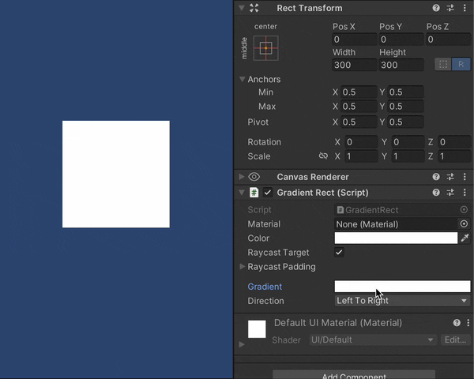

# Gradient Rect
[](https://openupm.com/packages/com.gilzoide.gradient-rect/)

Unity UI components with color [Gradients](https://docs.unity3d.com/ScriptReference/Gradient.html) embedded in their meshes.




## Features
- Uses Unity's built-in Gradient class.
- Supports additional color tint, 2D textures and sprites.
- Supports custom materials and masking.
  Gradient colors are embedded in the generated meshes, the components will never mess with your materials.
- Supports mesh modifiers, like Outline and Shadow.


## How to install
Either:

- Install using [openupm](https://openupm.com/):
  ```
  openupm add com.gilzoide.gradient-rect
  ```

- Install via [Unity Package Manager](https://docs.unity3d.com/Manual/upm-ui-giturl.html) using the following URL:
  ```
  https://github.com/gilzoide/unity-gradient-rect.git#1.2.0
  ```


## Components:
- [Gradient Rect (Legacy)](Runtime/GradientRect.cs): rectangle colored with Gradient colors.
- [Gradient Texture (Legacy)](Runtime/GradientTexture.cs): texture with configurable UV, tinted with Gradient colors.
- [Gradient Image (Legacy)](Runtime/GradientImage.cs): sprite tinted with Gradient colors.
  UVs are automatically fetched from sprite data.
  Only simple filling is supported, no slicing nor tiling.
- [Gradient Image Effect](Runtime/GradientImageEffect.cs): adds a gradient to a standard Unity UI `Image`.
  Add it via **Add Component → UI → Effects → Gradient Image Effect**, then set **Gradient** and **Angle**.
  An angle of 0° runs left to right, 90° bottom to top, 180° right to left, and 270° top to bottom.
  With Preserve Aspect enabled, the gradient spans the fitted sprite. Fill Amount clips the gradient without shifting or rescaling it.
  In Linear color space, colors are sampled in the same space Unity uses to interpolate UI vertices, keeping the gradient consistent across Image types.
  Keep using the Image inspector for slicing, tiling, and other Image settings. The effect multiplies the existing tint and uses the Image's material.
  If subdivision would exceed uGUI's vertex limit, the effect samples the gradient on the existing vertices.
- [Gradient Texture Effect](Runtime/GradientTextureEffect.cs): adds a gradient to a standard Unity UI `RawImage`.
  Add it via **Add Component → UI → Effects → Gradient Texture Effect**, then set **Gradient** and **Angle**.
  Set **Texture** and **UV Rect** on the Raw Image. The gradient spans the UI rect independently of the texture's UVs.
